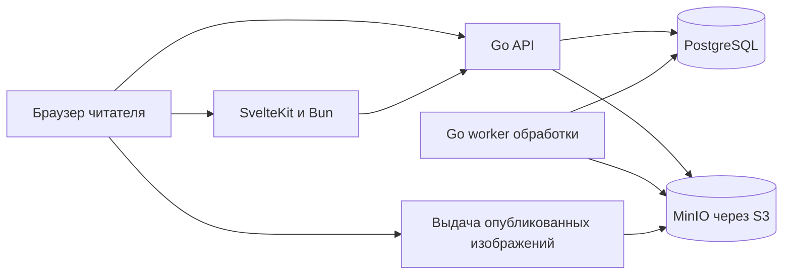

# Qmanga и спецификация MVP

Статус: проект спецификации для обсуждения до разработки. Дата: 17 октября 2026 года.

Qmanga — сайт для чтения манги, манхвы и маньхуа на казахском языке. Читатель должен быстро найти перевод, начать читать с телефона и вернуться на то же место даже после обрыва связи. На хорошем устройстве и соединении доступно высокое качество. Несколько одобренных команд самостоятельно готовят главы к публикации.

## Подтверждённые требования

- Интерфейс и переводы на казахском языке.
- Mobile First для всего проекта, включая кабинет переводчиков и модерацию.
- Senkuro — основной референс по пользовательским сценариям и общему ощущению.
- Стек: Bun, Svelte, Tailwind, Go, PostgreSQL и MinIO.
- Слабый Android и нестабильный интернет — основные условия проектирования, а не отдельная поздняя оптимизация.
- Публикация доступна нескольким одобренным командам переводчиков.
- Проект сохраняется в приватном GitHub. Найден существующий приватный `maqsatto/qmanga`; новые документы добавляются к нему.
- Сейчас планируем продукт. Выбор сервера, тарифов и железа отложен по просьбе пользователя.

## Предлагаемые исходные решения

Следующие решения входят в проект спецификации и допускают изменение при её обсуждении: казахская кириллица в первом релизе; гостевое чтение без регистрации; регистрация по почте и паролю; единый каталог произведений; несколько переводов одной главы; проверка каждой публикации модератором в MVP; отсутствие платных глав и контента 18+ в первой версии.

Для запуска не нужны аниме, ранобэ, встроенный редактор перевода, платёжная система или социальная сеть. Цель MVP достигнута, когда новая команда может опубликовать проверенную главу, а читатель — найти, прочитать и продолжить её на слабом телефоне.

## Варианты продукта

| Вариант | Содержание | Компромисс |
| --- | --- | --- |
| Минимальная читалка | Каталог, загрузка только владельцем, чтение | Быстрый старт, но не выполняет требование нескольких самостоятельных команд |
| Платформа чтения и одобренных команд | Каталог, библиотека, качественная читалка, публикации, базовое общение | Рекомендуемый MVP; полный путь от команды до читателя |
| Большой аналог Senkuro | Всё выше, чаты, игры, валюта, премиум, большие социальные профили | Размывает основную задачу и существенно увеличивает объём |

Выбираем для проектирования второй вариант. Похожие сценарии и навигация важнее копирования каждого блока Senkuro. Результаты исследования: [SENKURO-AUDIT.md](SENKURO-AUDIT.md).

## Роли и права

| Роль | Возможности |
| --- | --- |
| Гость | Каталог, поиск, опубликованные тайтлы и главы, локальная позиция чтения, сохранение главы на устройстве |
| Читатель | Всё гостевое плюс библиотека, синхронизация прогресса, оценки, комментарии и уведомления |
| Участник команды | Черновики и файлы только своей команды и назначенных ей проектов |
| Редактор команды | Проверка порядка страниц, метаданных и отправка публикации на модерацию |
| Владелец команды | Управление участниками, назначение ролей команды, проекты и действия редактора |
| Модератор | Проверка публикаций, жалобы, скрытие материалов, ограничения нарушителей |
| Администратор | Одобрение команд и проектов, каталог, глобальные права, блокировки и журнал действий |

У человека может быть несколько команд с разными ролями. Роль администратора не следует из владения командой. Сервер проверяет членство и доступ к конкретному проекту для каждого изменения. Отзыв членства немедленно запрещает новые изменения и завершение ранее начатых загрузок.

Команда создаётся администратором по заявке вне сайта; самостоятельную подачу и сложную систему заявок можно добавить после MVP. Приглашение в команду привязывается к аккаунту и требует принятия приглашённым. Совместная публикация нескольких команд в одном релизе пока не поддерживается: у релиза один ответственный team_id; соавторы указываются в кредитах.

## Состав MVP

| Область | Обязательно в первом публичном релизе | Позже |
| --- | --- | --- |
| Главная | Свежие главы, подборка редакции, продолжить чтение | Персональные рекомендации и сложные топы |
| Каталог | Поиск, жанры, тип, статусы, сортировка, постраничная загрузка | Сотни меток, продвинутые исключения и поиск по сюжету |
| Тайтл | Описание, обложка, названия, авторы, жанры, статусы, команды, главы | Персонажи, франшизы, подробные графики |
| Читалка | Лента, страницы, направление, качество, прогресс, переходы | Развороты, сложные жесты, эффекты |
| Слабая сеть | Ограничение загрузок, повторы, локальная позиция, ручное сохранение одной главы | Автоскачивание серии и фоновая библиотека |
| Аккаунт | Вход, регистрация, подтверждение почты, восстановление доступа | Несколько провайдеров входа |
| Библиотека | Статусы, любимое, новые главы, продолжение | Произвольные списки и импорт с других сайтов |
| Общение | Комментарии тайтла и главы, один уровень ответов, спойлер, жалоба; оценка 1–10 | Личные сообщения, чат, реакции, медиа и длинные рецензии |
| Команды | Публичная страница, участники, проекты, черновики, загрузка и отправка | Магазины, донаты, расписания и аналитика команд |
| Модерация | Одобрение команд, проектов и релизов, жалобы, скрытие, журнал | Автоматическая классификация и сложные санкции |
| Уведомления | Новые главы из библиотеки и решения по своим публикациям внутри сайта | Push, Telegram, почтовые рассылки |

Сохранение главы работает в поддерживающем браузере после явного действия читателя. Это не гарантия вечного хранения: браузер может удалить локальные данные. Подробный договор поведения находится в [QMANGA-READER.md](QMANGA-READER.md).

## Карта экранов

Нижняя навигация телефона: «Басты бет», «Каталог», «Кітапхана», «Хабарламалар», «Мәзір». Термины — рабочая редакция; перед выпуском их проверяет носитель казахского языка. Поиск также доступен в верхней части каталога и главной. В читалке общая навигация скрыта и заменена управлением чтением.

| Экран | Основное содержание и действие |
| --- | --- |
| `/` | Продолжение чтения, свежие переводы, компактная подборка; открыть тайтл или следующую главу |
| `/catalog` | Поле поиска, активные фильтры, карточки, «Ещё»; найти произведение |
| `/titles/[slug]` | Название, тип, обложка, «Оқу»/«Жалғастыру», добавить в библиотеку; вкладки о тайтле, главы, комментарии |
| `/read/[releaseId]` | Страницы, счётчик, настройки, команда, следующая глава; продолжить с сохранённой позиции |
| `/library` | Статусы, любимое, непрочитанные обновления; продолжить чтение |
| `/downloads` | Сохранённые главы, качество, размер, готовность и удаление локальной копии |
| `/notifications` | Внутренние уведомления; явная отметка прочитанного |
| `/teams/[slug]` | Описание команды, участники с публичными ролями, проекты, последние публикации |
| `/me` и `/settings` | Минимальный профиль, тема, качество по умолчанию, настройки локальных данных |
| `/login`, `/register`, `/forgot-password` | Вход и восстановление; возврат на исходную страницу |
| `/studio` | Выбор своей команды и её проектов, статусы загрузок и решений |
| `/studio/releases/[id]` | Метаданные, загрузки, порядок страниц, предпросмотр, отправка на проверку |
| `/moderation` | Очередь релизов и жалоб; решение с причиной |
| `/admin` | Каталог, команды, участники и журнал действий |

Неавторизованный читатель при сохранении в облачную библиотеку видит предложение входа. Само чтение не блокируется. Локальное сохранение главы и позиции остаётся доступным гостю.

## Главная и каталог

Главная начинается с полезного действия: продолжение чтения для вернувшегося пользователя, новые переводы для нового. На старте вместо пустого «популярного» — подборка редакции. Не показывать вымышленные рейтинги и просмотры.

Карточка: обложка, казахское название, тип, последняя доступная глава. Личный прогресс появляется у пользователя, который начал чтение. Рейтинг показывается с количеством оценок; если оценок нет, отображается отсутствие данных, а не 0/10.

Поиск учитывает казахское, оригинальное и альтернативные названия. Ввод не должен стирать «ә», «ғ», «қ», «ң», «ө», «ұ», «ү», «һ», «і». Поиск по отдельным алиасам допускает распространённые варианты написания, но исходное название сохраняется. Пустая выдача предлагает убрать фильтры. Ввод короче двух символов не запускает тяжёлое нечёткое сравнение.

Фильтры MVP: жанры, тип произведения, статус оригинала и статус перевода; отдельный переключатель «есть опубликованные главы». Сортировка: недавно обновлённые, новые произведения, название. Рейтинг как сортировка добавляется, когда появятся реальные оценки. Выбор фильтров записывается в URL, сохраняется после возврата и применяется одной кнопкой в мобильной панели.

## Страница тайтла и выбор перевода

Оригинал и его казахский перевод имеют независимые статусы. Законченное произведение может всё ещё переводиться. Публикация новых глав не означает автоматического завершения перевода.

На одном произведении могут работать разные команды. У каждой команды свой проект перевода и свои релизы глав. Одинаковый номер от двух команд не создаёт два разных произведения. Читатель выбирает предпочитаемый проект; следующая глава берётся из него. Если нужного релиза нет, предложить альтернативную команду явно, без автоматической подмены.

Список глав группируется по логическим главам, а внутри раскрывает доступные переводы. Для небольшого количества достаточно компактного выбора команды над списком. Дробный номер, том, часть и спецвыпуск отображаются отдельно от идентификатора и сортировки. «10.10» не хранится как float и не обязано совпадать с «10.1».

Первая кнопка начинает с первой опубликованной главы выбранной команды или продолжает текущую. После последней страницы глава считается прочитанной только после её фактического просмотра и продвижения; простое открытие вкладки не завершает главу. Глобальный статус «Прочитано» пользователь меняет сам.

## Библиотека и уведомления

Основные статусы: reading, planned, completed, on_hold, dropped. Избранное — отдельный флаг, совместимый с любым статусом. Казахские подписи проходят языковую проверку. Библиотека может существовать без начатого чтения; чтение само не добавляет тайтл в облачную библиотеку.

«Продолжить» хранит конкретный релиз, страницу и относительное положение внутри длинного фрагмента. Отдельно хранится наиболее дальняя завершённая логическая глава. Это позволяет перечитывать начало, не теряя сведения о пройденных главах.

Уведомления о новых главах получают пользователи, явно включившие обновления у записи библиотеки. По умолчанию предложение подписки включено для «Читаю» и «В планах», но итоговое значение видно и меняется отдельно. События при нескольких новых релизах группируются по тайтлу. Читатель видит обновления предпочитаемой команды; смена команды не порождает историю старых уведомлений. Для записи без выбранной команды предложить выбрать её, пока уведомлять о новых логических главах единожды независимо от дублей перевода.

Неудачная синхронизация не рисует успешное облачное сохранение. Повторные события не создают дубли уведомлений. Офлайн-изменения библиотеки показываются как ожидающие отправки; последний применённый сервером вариант имеет свою версию, конфликт предлагается разрешить пользователю.

## Путь команды от файлов до главы

1. Администратор одобряет команду и назначает владельца. Команде разрешается проект конкретного произведения; новый тайтл сначала создаёт администратор.
2. Участник создаёт черновик релиза: логическая глава, название, номер/часть, кредиты. Язык публикации в MVP фиксирован: kk.
3. Загружает JPG, PNG или WebP по одному или несколько сразу. Нумерованные имена сортируются естественно: 2 перед 10. Исходный порядок всегда виден.
4. Незавершённая загрузка возобновляется. Готовые файлы не передаются повторно. Закрытие вкладки не удаляет серверный черновик.
5. Обработка проверяет изображения и строит варианты качества. На экране видны ожидающие, обрабатываемые, готовые и ошибочные страницы.
6. Редактор проверяет порядок. На телефоне доступен перенос кнопками вверх/вниз и указанием позиции; drag-and-drop — дополнительный способ.
7. Просматривает главу как читатель, включая режим экономии, и отправляет на модерацию. После отправки эта ревизия заморожена.
8. Модератор принимает или возвращает с причиной. Публикация доступна только после обработки всех обязательных файлов и успешного решения.
9. Глава появляется в каталоге, на странице команды и в уведомлениях. Операция повторяемая: двойное нажатие не публикует дважды.
10. Исправление создаёт новую ревизию. Старая опубликованная версия работает до одобрения замены. После атомарной смены версии обновляются manifest и ссылки; прежние файлы удаляются после периода сохранения, если нет ограничений на распространение.

Состояния ревизии: draft → uploading → processing → ready → submitted → published. Из submitted возможен возврат changes_requested; редактирование создаёт новую проверяемую ревизию. Ошибки обработки относятся к файлам и заданиям и не позволяют пройти к ready. Снятый релиз получает withdrawn; старые адреса показывают понятное сообщение.

Черновик сохраняется автоматически с видимым состоянием «сохранено/нет связи». Отмена удаления файла доступна до сохранения нового порядка. Модератор не исправляет молча чужие изображения: возвращает работу с причиной или скрывает опубликованное при нарушении.

## Общение и модерация

В MVP — текстовые комментарии к тайтлу или релизу и один уровень ответов. Доступны метка спойлера, редактирование своего текста, удаление своего комментария, жалоба и модераторское скрытие. HTML, внешние изображения и вложения не разрешены. Ответы скрытого родителя сохраняют понятную заглушку.

Оценка произведения — одно целое число 1–10 на подтверждённый аккаунт, с возможностью изменить или снять. Не требуем оценивать каждую главу. Счётчики не включают удалённые оценки и заблокированные накрутки; на старте важнее число оценок, чем место в топе.

Жалоба имеет категорию: сломанная страница, порядок страниц, ошибка перевода, спойлер/оскорбление, права на материал, другое. Для технической жалобы автоматически прикрепляются ID релиза и страницы, без переписки и личной истории читателя. Есть состояние рассмотрения и результат. Отдельная форма контакта по правам доступна без аккаунта.

До публикации команда подтверждает право размещения материала. У релиза фиксируются источник/основание и ответственный. Снятый материал исчезает из публичной выдачи и удаляется из управляемых кешей; ранее сохранённую на отключённом устройстве копию дистанционно удалить невозможно.

## Mobile First как договор интерфейса

- Проектировать сначала 360 px; обязательная пригодность от 320 px. Проверять 360, 390, 412, 768 и 1280 px.
- Основные действия имеют область нажатия минимум 44 × 44 CSS px. Минимальный основной текст — 16 px.
- Кнопки, поиск и фильтры работают касанием и клавиатурой. Нет функций только по hover.
- Основное действие доступно большим пальцем; нижнее меню учитывает safe area и не перекрывает контент.
- В каталоге две колонки на узком телефоне; количество колонок растёт по доступной ширине.
- Панели на телефоне занимают доступную высоту; внутренний скролл, фокус и кнопка закрытия не теряются при открытии клавиатуры.
- Android «Назад» закрывает панель, затем возвращает на предыдущий экран; фильтры и позиция выдачи сохраняются.
- Анимации необязательны и отключаются при reduced motion; большие размытые фоны не используются в читалке.
- Светлая, тёмная и системная темы сохраняются; перед первым кадром нет вспышки противоположной темы.
- У изображений известны размеры до загрузки. Ошибка картинки оставляет её место и кнопку повтора.
- Пустой каталог, отсутствие глав, ошибка, нет сети и недостаток места имеют отдельные казахские сообщения и следующий шаг.
- В кабинете команды таблицы на телефоне превращаются в карточки. Все операции загрузки и проверки доступны без компьютера.

Tailwind применяет стили без префикса как базовые, а брейкпоинты расширяют их; это соответствует его [модели mobile first](https://tailwindcss.com/docs/responsive-design). Адаптивность Senkuro исследована, но физический Android для Qmanga предстоит проверить отдельно.

## Казахский язык

Основной locale — kk-KZ, язык контента — kk. Интерфейс первой версии использует казахскую кириллицу. Вся текстовая система отделена от компонентов: кнопки, ошибки сервера, письма, уведомления, формы и состояния загрузки. Русский текст в этих документах — язык планирования, а не язык готового сайта.

Примеры рабочих терминов: «Оқу», «Жалғастыру», «Тараулар», «Аударма», «Аудармашылар», «Сақтау», «Қайталау», «Интернет жоқ». Тексты и терминология переводов проверяются носителем до выпуска. Форматы дат и чисел строятся через Intl для kk-KZ; системные даты хранятся в UTC.

Названия на оригинальном языке и алиасы не требуют перевода. Описание и основное название для опубликованного тайтла должны иметь казахскую версию. Шрифты обязательно содержат все казахские буквы; сначала использовать системный стек без загрузки декоративных гарнитур.

## Архитектура приложения

Рекомендуется один Go backend с внутренними модулями и отдельным процессом обработки изображений из той же кодовой базы. SvelteKit отвечает за страницы и первоначальный HTML, Bun — за инструменты и сервер SvelteKit, Tailwind — за стили. Единственный источник бизнес-правил и прав доступа — Go. PostgreSQL хранит записи и очередь обработки; MinIO хранит бинарные файлы через S3 API.

| Подход | Плюсы | Недостатки |
| --- | --- | --- |
| SvelteKit SSR и Go API | Быстрое первое содержимое, SEO, разделение UI и бизнес-правил | Нужен согласованный контракт двух приложений; рекомендуемый вариант |
| Svelte как SPA и Go | Проще отдача фронтенда | Начальная зависимость от JS хуже для слабого телефона и поиска |
| Набор микросервисов | Независимое развитие больших подсистем | В MVP неоправданно усложняет согласованность и отладку |

Пути страниц, `/api/v1` и `/media` доступны под одним origin. SvelteKit не читает БД напрямую. Для SSR приватных страниц он передаёт в Go только необходимую сессию и запрос, не принимает от браузера произвольную роль пользователя. API возвращает тот же контракт и браузеру, и SSR.

| Модуль Go | Ответственность |
| --- | --- |
| identity | Аккаунты, сессии, подтверждение почты, восстановление |
| catalog | Произведения, названия, жанры, главы и поиск |
| teams | Членство, роли и проекты переводов |
| publishing | Черновики, ревизии, загрузки, решения и публикация |
| reader | Manifest, порядок фрагментов, прогресс и предпочтения |
| library | Статусы, любимое, новые главы |
| community | Комментарии, оценки и жалобы |
| notifications | События и внутренняя лента |

Новые Redis, Elasticsearch, GraphQL и WebSocket для MVP не нужны. Обновление статуса обработки — обычным периодическим запросом с увеличением интервала при скрытой вкладке. Поиск начинается с PostgreSQL, нормализованных полей и pg_trgm, без предположения о встроенной казахской морфологии. [pg_trgm поддерживает поиск сходства и индексы](https://www.postgresql.org/docs/current/pgtrgm.html).

Точные версии зависимостей фиксируются при начале реализации после проверки совместимости. Текущая [документация официального адаптера Bun](https://svelte.dev/docs/kit/adapter-bun) описывает запуск SvelteKit на Bun и требование Bun 1.4+. В проекте нельзя переносить старую конфигурацию SvelteKit из случайного туториала без проверки выбранной версии.

## Модель данных

| Сущность | Назначение и ограничения |
| --- | --- |
| users, sessions | Аккаунт; случайная отзываемая сессия, в БД только её хеш |
| verification_tokens | Одноразовые хешированные токены подтверждения и восстановления со сроком |
| titles, title_names | Произведение и названия с locale и типом alias; уникальный slug |
| authors, title_authors | Автор и роль в произведении |
| genres, title_genres | Управляемый небольшой набор жанров |
| teams, team_memberships | Команда и роль человека; уникальность team_id + user_id |
| team_invitations | Приглашение, адресат, срок, принятие/отмена |
| translation_projects | Связь title + team + language; статус перевода и разрешение работы |
| chapters | Логическая глава произведения; label, volume, part и отдельный sort_key |
| releases | Перевод главы конкретного проекта; current_published_revision_id |
| release_revisions | Неизменяемая после отправки версия страниц, состояния и решения |
| upload_sessions, upload_files | Владелец загрузки, допустимый ключ, размер, checksum, состояние и срок |
| source_pages | Порядок оригинальных страниц, размеры, объект в хранилище, checksum |
| image_variants | Профиль качества, размер, mime, byte_size, фрагменты и связь с оригиналом |
| jobs | Обработка, lease, число попыток, ошибка и уникальный ключ задания |
| outbox_events | Событие публикации в той же транзакции, что и смена опубликованной ревизии |
| library_entries | user + title, статус, любимое, notifications_enabled, preferred_project_id и версия |
| reading_progress | user + title, latest position, furthest completed chapter, server version |
| progress_events | device_id, event_id, base_version и данные для устранения повторов и конфликтов |
| ratings | Одна оценка 1–10 на user + title |
| comments | target title/release, author, parent, spoiler, состояние, даты изменения |
| reports | Категория, цель, заявитель, обработка и решение |
| notifications | Получатель, событие, target, прочитанность; уникальный ключ доставки |
| audit_log | Кто, когда и что изменил в командах, публикации и модерации |

Идентификаторы не кодируют отображаемые номера глав. Сортировка глав явно задаётся сервером и проверяется редактором; для MVP используется последовательный целочисленный sort_key, вставка с перенумерацией в транзакции. Дубликат релиза в одном проекте и главе запрещён, исправление оформляется ревизией.

Страницы оригинала и нарезанные фрагменты связаны явно, чтобы переключение качества возвращало к тому же месту. Нельзя принимать каждый вертикальный кусок за новую логическую страницу. При повторной публикации изменившаяся позиция привязывается к исходной странице; если её больше нет, читателю предлагается ближайшая существующая с объяснением.

## Контракты API

Имена маршрутов — проект контракта. JSON имеет стабильные коды ошибок и казахское сообщение на клиенте. Списки ограничены по размеру и используют cursor. Закрытые ответы не кешируются общим кешем.

| Группа | Операции |
| --- | --- |
| `/api/v1/auth` | register, login, logout, verify-email, forgot-password, reset-password |
| `/api/v1/titles` | Список с поиском/фильтрами, тайтл, главы и доступные проекты |
| `/api/v1/releases/{id}/manifest` | Только текущая опубликованная ревизия и варианты изображений |
| `/api/v1/me` | Профиль, настройки, библиотека, прогресс, уведомления |
| `/api/v1/me/progress-events` | Идемпотентная отправка пакета локальных событий с версиями |
| `/api/v1/teams` | Публичный профиль; изменения только для уполномоченных участников |
| `/api/v1/studio` | Черновики, ревизии, upload sessions, complete upload, reorder, preview, submit |
| `/api/v1/comments` и `/ratings` | Чтение и разрешённые изменения своего содержимого |
| `/api/v1/reports` | Создать жалобу; очередь и решения только для модератора |
| `/api/v1/moderation` | review, publish, request-changes, withdraw; обязательная причина возврата/снятия |

Общие коды: unauthorized, forbidden, validation_error, conflict, upload_incomplete, processing_failed, rate_limited, not_found, withdrawn. При 429 клиент учитывает Retry-After. На устаревшую версию черновика отвечает 409, а не перезаписывает чужую работу. Повтор submit/publish с тем же idempotency key возвращает исходный результат.

## Файлы и публикация

Оригиналы и черновики приватны. Короткие разрешения на загрузку ограничены конкретным ключом, владельцем и сроком; сервер после загрузки сверяет фактический размер и checksum и повторно проверяет права. Хранилищу не передаются постоянные ключи в браузер. Большой файл использует multipart, незавершённые сессии имеют срок очистки.

Стартовые ограничения продукта: одна исходная картинка до 25 MiB, глава до 500 MiB суммарно и до 300 исходных страниц; общий предел декодирования одной картинки 80 MP. Эти пределы проверяются и интерфейсом, и сервером до тяжёлой обработки; при превышении команда получает понятную причину. ZIP, PDF, SVG и GIF не входят в загрузки MVP. Архивы можно добавить после безопасной отдельной проработки.

Обработчик работает вне API-процесса, с лимитами времени и памяти; проверяет реальный формат, размеры, количество кадров и успешное декодирование. В выходных файлах удаляются EXIF и лишние метаданные. Длинные вебтуны делятся на ограниченные по высоте фрагменты без разрывов и потерянных строк.

Задания забираются через PostgreSQL с lease и блокировкой строк; повтор после падения безопасен по ключу source checksum + profile + processor_version. Неудачные задания видны редактору и доступны к повтору. Релиз не публикуется частично. Смена указателя на полностью готовую ревизию и событие outbox выполняются атомарно; уведомления доставляются повторяемым обработчиком.

## MinIO в проекте

MinIO сохраняется в запрошенной архитектуре за узким интерфейсом S3: Put, Get, Head, Delete, multipart и scoped upload. Приложение не зависит от конкретной панели администрирования хранилища. [Официальный репозиторий MinIO](https://github.com/minio/minio) архивирован 25 апреля 2026 года и объявлен неподдерживаемым. Поэтому выбор поддерживаемой поставки MinIO либо другого совместимого хранилища необходимо отдельно подтвердить перед выпуском; реализация читательских сценариев от этого выбора не зависит. Разбор лицензии и конкретной поставки относится к этому отдельному решению.

## Авторизация и целостность

Сессии в HttpOnly, Secure, SameSite cookie; не в localStorage. Все операции изменения проверяют origin/CSRF и объектные права. Пароли хешируются Argon2id, одноразовые токены имеют срок и хранятся в виде хеша. Вход, восстановление, комментарии и загрузки ограничиваются по частоте. Ответ восстановления не раскрывает наличие почты.

Публичное чтение не требует подтверждённой почты; комментарии, оценки и участие в командах требуют. Не загружать сторонние трекеры на экран чтения. Не писать токены, почту и полный текст запросов пользователя в технические логи. Админские действия имеют журнал, но журнал не хранит секреты.

## Критерии готовности MVP

1. Гость на телефоне находит тайтл по казахскому или альтернативному названию и читает без регистрации.
2. Читатель выбирает команду; переход вперёд не меняет перевод без его решения.
3. После обрыва сети сохраняются место и уже загруженные фрагменты; есть понятный повтор.
4. Режим экономии действительно снижает передаваемые байты, а качество текста проходит проверку носителем языка.
5. На слабом Android длинная глава не приводит к постоянному росту числа декодированных изображений и аварийному завершению вкладки.
6. Можно явно сохранить одну главу, увидеть её готовность и открыть после отключения сети и перезапуска браузера, если браузер сохранил данные.
7. Облачный прогресс синхронизируется после восстановления сети и не откатывается молча из-за старого офлайн-события.
8. Две команды выпускают переводы одной главы без конфликтов и доступа к чужим черновикам.
9. Редактор с телефона загружает файлы, меняет порядок и отправляет главу; модератор возвращает или публикует её.
10. Скрытый релиз недоступен через публичный manifest; новая ревизия появляется целиком и не смешивается со старой.
11. Комментарии, спойлеры, жалобы и одна оценка на аккаунт работают с проверкой прав и защитой от повторов.
12. Все пользовательские строки, ошибки и письма на казахском, включая проблемные и пустые состояния.
13. Подготовлены несколько реальных разрешённых к публикации произведений и полный путь хотя бы одной команды; пустой демонстрационный каталог не считается запуском.

Порядок выполнения и точки проверки: [QMANGA-ROADMAP.md](QMANGA-ROADMAP.md). Подробности сети, качества, локального хранения и слабых устройств: [QMANGA-READER.md](QMANGA-READER.md).
