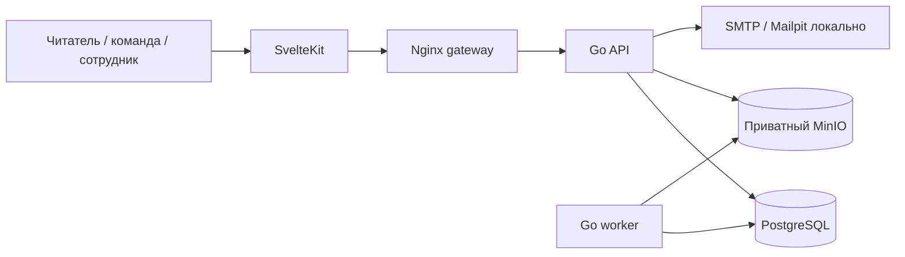

# Qmanga: независимый аудит состояния проекта

Дата: 18 октября 2026 года. Проверяемый срез: `46737a0`, исходно чистое рабочее дерево. Аудит охватывает продукт, пользовательские сценарии, интерфейс, работу команды перевода, модерацию, администрирование, архитектуру, разработку и эксплуатацию.

Связанный документ: [план развития с критериями приёмки](DEVELOPMENT-PLAN-2026-10-18.md).

## 1. Вердикт

**Qmanga — работающая функциональная альфа с существенной инженерной основой. Готовность к устойчивому публичному запуску пока не доказана.** Это не пустой макет: публикация через обработчик изображений, чтение, прогресс, библиотека, обсуждения и модерация существуют и проходят значительную часть проверок. Однако наличие этих функций опережает качество их совместного использования.

Главная проблема — разрывы между отдельными возможностями. Админка предлагает переход, который запрещён её же пользователю. Офлайн-читалка работает, но вход в список скачанного требует сети. Поиск и фильтры в нескольких разделах работают только по уже загруженной части данных. Обложка произведения зависит от первой страницы последней опубликованной главы. Сборка при этом остаётся зелёной.

Поэтому ближайшая цель — **надёжная закрытая бета с целостными сценариями**, а не расширение списка функций, смена стека или новый общий редизайн. Нужны исправления контрактов, полноценные проверки браузерных переходов и удобные рабочие инструменты для людей, которые обеспечивают контент.

Оценки «готово на 85%» или единый балл из десяти здесь создавали бы ложную точность. По коду нельзя измерить удержание аудитории, удобство для реальных переводчиков, устойчивость под нагрузкой или качество казахского текста. Ниже оценка разложена по проверяемым направлениям.

| Направление | Состояние | Основание |
| --- | --- | --- |
| Базовая серверная архитектура | Разумная основа, требует уточнения границ | Модульный монолит, явные контексты и порты; есть межконтекстные записи в БД |
| Публикация и обработка изображений | Работает, операторский сценарий сырой | Реальный worker и выдача WebP проверены; штатный smoke устарел, редактор неудобен для объёмных глав |
| Обычное чтение | Наиболее убедительно проработанная часть | Изображения, режимы, качество, сохранение позиции и повторное открытие работают на тестовой главе |
| Поиск, библиотека, возвращение к чтению | Частично готовы | Основной каталог использует серверный поиск; персональные и внутренние списки имеют ошибки полноты/сортировки |
| Офлайн | Рабочий механизм, незавершённый пользовательский путь | Скачанная глава читается без сети; прямой вход через `/saved` не работает |
| UI | Есть согласованное направление; качество экранов неравномерно | Две темы, компактная навигация и обложки; формы управления и карточка тайтла перегружены вторичными действиями |
| Доступность | Частичная проверка | Есть семантика, состояния и проверки контраста токенов; полная работа с клавиатурой/скринридером не доказана |
| Переводчик / владелец команды | Функции есть, ежедневная работа недостаточно удобна | Нет визуальных миниатюр страниц, защиты части несохранённых правок, полного жизненного цикла приглашений |
| Модератор / администратор | Базовые действия есть, расследование и навигация слабы | UUID вместо контекста, недостаточная очередь работы, воспроизведён запрещённый переход администратора |
| DX и тестирование | Хорошие локальные проверки, слабая воспроизводимость полного пути | Контейнерная сборка проверяет много слоёв; холодный старт и один штатный smoke падают; CI не найден |
| Эксплуатация | До публичного запуска есть обязательная работа | Нет доказанного восстановления, оповещений о зависшем worker, production-конфигурации доверенных прокси |
| Продуктовая результативность | Не измерена | Нет наблюдаемой воронки активации/возврата и данных реальной аудитории |

## 2. Как проводилась проверка

Использованы чтение исходников и схем БД, сопоставление с документацией, сборка приложения, интеграционные проверки и взаимодействие с запущенным интерфейсом. Пользовательские данные старых Docker volumes не удалялись. Для тестов создан отдельный Compose-проект `qmanga-audit-20261018` с отдельной БД и хранилищем. Изображения — три локально сгенерированные геометрические страницы, без чужих иллюстраций.

### Свежие результаты

| Проверка | Результат | Что это означает |
| --- | --- | --- |
| `go test ./...` на хосте | Успешно | Быстрая проверка; сама по себе не доказывает прохождение PostgreSQL/кодеков |
| Контейнерная сборка API и web | Успешно | Приложение компилируется |
| Svelte приложения | 0 ошибок, 0 предупреждений | Статическая проверка компонентов и типов |
| Проверки архитектуры frontend и контраста токенов | Успешно | Проверены заданные правила, а не вся архитектура/доступность |
| Bun: application/domain/adapter tests | 41 успешно, 196 assertions | 27 тестовых файлов в этом запуске |
| Svelte SSR UI tests | 23 успешно, 632 assertions | 6 файлов; проверка разметки при серверном рендере, не полноценных действий браузера |
| UI preview и production build | Успешно | Галерея компонентов и сборка SSR/client/prerender |
| Контейнерные Go-тесты с реальным PostgreSQL и ImageMagick | Успешно | Включая интеграционные проверки и реальные кодеки |
| Auth smoke | Успешно | Регистрация, локальное письмо, подтверждение, сброс, CSRF и выход |
| Штатный publishing smoke | **Ошибка 409 при submit** | Не заполняет добавленные обязательные сведения об источнике/правах |
| Временная копия publishing smoke с заполнением attribution | Успешно | Upload → worker → moderation → публикация; WebP трёх уровней, байты, MIME и checksum через Go |
| Reading smoke | Успешно | Изоляция библиотек, replay/conflicts/account guard, рейтинги, комментарии, жалобы, уведомления и privacy reader HTML |
| Первый `docker compose up -d --build --wait` без локального API image | **Ошибка pull `qmanga-api:latest`** | Worker пытается получить ещё не собранный локальный образ |

Второй запуск со старыми volumes выявил другую ситуацию: исходный `.env` отсутствовал, а setup создал новые случайные реквизиты, которые не совпали с реквизитами старой БД. Это **не записано как дефект аутентификации приложения**. Это важный случай восстановления локальной среды: инструкция должна различать новую установку и повторное подключение старых данных. Тесты затем проведены в изолированной среде.

### Что действительно проверялось в браузере

- Главная и каталог, пустое и наполненное тестовым контентом состояние.
- Настройки, казахский/русский интерфейс и светлая/тёмная тема.
- Мобильные размеры 320/360 px для отдельных экранов; карточка тайтла также на 1280 px.
- Админский каталог и фактический переход администратора в проект.
- Карточка произведения, читалка, перелистывание, повторное открытие с сохранённой страницей.
- Скачивание трёхстраничной главы; повторная загрузка офлайн-читалки и декодированная следующая страница при отключённой сети.
- Прямое открытие `/saved` без сети — ошибка загрузки.
- Меню модерации и пустая очередь обращений после smoke-проверок.

Ролевые серверные сценарии дополнительно проверялись тестами и анализом контрактов. Это не означает, что каждый экран каждой роли пройден вручную во всех состояниях.

### Границы выводов

Не проводились физические Android/iOS тесты, нагрузочные испытания на большом каталоге, реальная внешняя доставка email, полноценный pentest, аудит юридических документов, проверка восстановления с резервных копий и исследования с живыми читателями/переводчиками. Тестовая глава короткая; она не доказывает устойчивость читалки на длинных webtoon и слабых телефонах. Пустые локальные данные не считаются доказательством отсутствия реального контента у владельца проекта.

В реестре используются три вида основания: **воспроизведено**, **подтверждено кодом**, **риск/не проверено**. Для P1 рекомендуется исправление до расширения беты или публичного запуска; P2 — существенное улучшение рабочего сценария; P3 — последующее развитие. Обнаруженных и подтверждённых катастрофических уязвимостей уровня P0 в этот список не включено.

## 3. Структура и архитектура

### Что устроено правильно

Текущий размер проекта соответствует модульному монолиту: один Go API, отдельный процесс worker, PostgreSQL, приватное объектное хранилище, SvelteKit и gateway. Семь основных сервисов Compose и 16 миграций — уже ощутимая эксплуатационная сложность, но пока нет оснований добавлять отдельные сервисы для каждого контекста.

Контексты Identity, Teams, Catalog, Publishing, Reading, Community и Notifications отражают реальные бизнес-задачи. Различение title → chapter → team release → immutable revision особенно полезно: оно позволяет иметь несколько переводов, исправления и модерацию без перезаписи опубликованного содержимого.

Это схема ответственности и потоков, а не точная сетевая топология SSR: серверный SvelteKit также обращается к внутреннему API.

В frontend отдельные domain/application/infrastructure/presentation, браузерная и серверная композиция. Это позволяет проверять политику чтения и конфликты прогресса отдельно от Svelte. Порты и конкретные транзакционные операции лучше подходят этому проекту, чем универсальный CRUD-репозиторий.

Положительные инженерные свойства не только заявлены: используются версии изменяемых объектов, проверка повторной доставки событий, разграничение аккаунтов, приватность исходников, lease/fencing для обработки, серверная авторизация и реальные интеграционные тесты.

### Где структура расходится с заявленной моделью

В [ARCHITECTURE.md](ARCHITECTURE.md) запрещена запись в состояние другого контекста. В действительности Publishing обновляет `titles.cover_asset_id` и `titles.updated_at`; транзакции включают данные нескольких владельцев. Это не делает код автоматически плохим, но означает, что формально заявленная граница сильнее фактической.

Нужно определить владельца каждого изменения и явно описать допустимые транзакционные взаимодействия. Для публикации и изменения каталога можно использовать узкий application-контракт или осознанную общую транзакцию с указанным владельцем. Не следует вводить распределённые события там, где нужна простая атомарность одной БД.

Часть application services тонкая, а проверки доступа и бизнес-инварианты находятся в SQL-адаптерах. Для блокировок и конкурентных изменений это часто оправданно. Проблема в том, чтобы правила не дублировались и документация не обещала иной модели. Тест импорта не может проверить корректность владения SQL-таблицами.

В presentation есть очень плотные файлы: Reader примерно 31 KB на 146 строк, PublishingStudio около 22 KB на 70 строк, ProjectRequests около 16 KB на 64 строки. Здесь важна не длина файла сама по себе: многие операции и большие блоки разметки записаны в одну строку. Это осложняет чтение diff, локализацию ошибок, review и точечные изменения.

Разумная доработка: стандартное форматирование, небольшие компоненты по устойчивым задачам и вынесение повторяемой оркестрации. Не нужен механический рефакторинг всех файлов и дополнительные слои ради структуры каталогов.

В корне и `docs` накопилось несколько планов, аудитов и исторических статусов. Это полезная история, но новичку сложно понять, какой документ действующий. Например, README всё ещё говорит об отложенном общем редизайне, а актуальный UI brief уже фиксирует его согласование и поправки владельца. Нужны один индекс документации, один текущий backlog и явные пометки «исторический документ».

## 4. Подтверждённые дефекты и пробелы

### A01 — холодный запуск зависит от уже существующего образа, P1

**Воспроизведено.** В [compose.yaml](../compose.yaml) API имеет `build`, а worker использует `image: qmanga-api:latest`. На первом запуске Compose пытается скачать worker image и падает с `pull access denied` до нормальной сборки общего образа. После явной сборки API этот барьер обходится.

Последствие: новый разработчик получает неработающий рекомендованный путь запуска. Успех на прогретой машине скрывает проблему.

Исправление: явно описать общий образ/build и поведение pull, проверить чистый image cache и произвольное имя Compose-проекта. Отдельно документировать восстановление среды с сохранившимися volumes и утраченным `.env` без удаления данных.

### A02 — штатная проверка публикации устарела, P1

**Воспроизведено.** [smoke-publishing.ps1](../scripts/smoke-publishing.ps1) отправляет обработанную главу на проверку без обязательного attribution. API корректно отказывает `409 state`. Временная копия с источником, credits и подтверждением прав проходит весь путь.

Это дефект тестового инструмента, а не основание отключать проверку прав. Следует обновить штатный smoke и включить его в повторяемый путь приёмки. Ошибка также показывает, что зелёная сборка не гарантирует совместимость основных сценариев.

### A03 — ссылка администратора ведёт в запрещённый проект, P1

**Воспроизведено и подтверждено кодом.** [AdminCatalogue.svelte:53](../apps/web/src/lib/features/catalog/presentation/AdminCatalogue.svelte#L53) выводит `/studio/projects/{id}`. [PublishingStudio.svelte:29](../apps/web/src/lib/features/publishing/presentation/PublishingStudio.svelte#L29) сначала загружает studio project. [StudioProject](../backend/internal/catalog/adapters/postgres/studio.go#L195) требует membership текущего пользователя в команде и не имеет отдельного staff-контракта. Администратор вне команды видит отказ и при этом остатки пустой формы.

Исправление: определить, нужен ли staff просмотр, редактирование или отдельная административная карточка; согласовать ссылку, API и экран. Не выдавать глобальное право редактирования только ради устранения ошибки навигации. Проверить owner/editor/member/moderator/admin вне команды и заблокированного пользователя.

### A04 — ложное сообщение «Сохранено», P2

**Воспроизведено.** [AdminCatalogue.svelte:21–23](../apps/web/src/lib/features/catalog/presentation/AdminCatalogue.svelte#L21) использует общий `operation`, который после любой операции показывает `saved`, включая начальную загрузку и выбор тайтла.

Последствие: интерфейс даёт ложную обратную связь и перестаёт помогать понять, какие правки действительно записаны. Разделить загрузку и изменение; успех показывать для конкретного подтверждённого действия.

### A05 — у произведения нет независимого жизненного цикла обложки, P1

**Подтверждено кодом.** [Publishing repository:329](../backend/internal/publishing/adapters/postgres/repository.go#L329) при публикации записывает в обложку тайтла первый `eco`-фрагмент новой ревизии. При снятии соответствующей ревизии [обложка обнуляется](../backend/internal/publishing/adapters/postgres/repository.go#L355).

Таким образом, следующая глава может заменить узнаваемую обложку первой страницей, а снятие главы — убрать её. Это особенно плохо для согласованного интерфейса, где выбор произведения строится вокруг обложек. Для анонса без главы тоже нужен собственный путь добавления обложки.

Исправление: отдельный asset/контракт обложки тайтла, безопасная обработка и редактирование метаданных. Автоматическую первую страницу можно сохранить только как явно обозначенный fallback, без перезаписи выбранной обложки. Поведение при отзыве контента определить отдельно.

### A06 — фильтры показывают неполную картину, P1

**Подтверждено кодом; большой набор данных вручную не прогонялся.** В [Library.svelte](../apps/web/src/lib/features/reading/presentation/Library.svelte#L26) фильтр статуса/избранного применяется к загруженным `entries`; API возвращает до 100 записей. В [Projects.svelte](../apps/web/src/lib/features/publishing/presentation/Projects.svelte#L28) фильтр команды также применяется после пагинации. Счётчик ожидающих заявок считает только полученную страницу.

Пользователь может увидеть «нет тайтлов/проектов», хотя совпадения находятся на следующей странице. Кнопка «ещё» не исправляет неверную семантику фильтра.

Нужны серверные фильтры, корректный cursor и отдельная семантика count. Если показывается только часть, это должно быть явно сказано. Основной публичный каталог уже имеет серверный поиск; к нему этот конкретный дефект не относится.

### A07 — поиск главы внутри читалки ограничен загруженным списком, P1

**Подтверждено кодом.** В [Reader.svelte:39](../apps/web/src/lib/features/reading/presentation/Reader.svelte#L39) локально фильтруется `chapters`; [loadChapters:67](../apps/web/src/lib/features/reading/presentation/Reader.svelte#L67) передаёт cursor, но не поисковый запрос и сортировку. Серверный контракт поиска глав существует в каталоге, однако этот экран его не использует.

Для длинных серий ввод номера далёкой главы не находит её до ручной загрузки предшествующих страниц. Исправить поиск и сортировку целого списка, проверять на серии с несколькими сотнями глав.

### A08 — «Продолжить» не основано на последнем чтении, P1

**Подтверждено кодом.** [loadContinuation](../apps/web/src/lib/features/reading/application/continuation.ts) набирает первые четыре подходящие записи из библиотечного списка. Сервер сортирует по ID тайтла, а не по времени последнего чтения. Гостевой список также берётся без явной сортировки по последнему чтению.

Дополнительно [главная](../apps/web/src/routes/+page.svelte#L14) передаёт обложки только из `mostRead`. Продолжаемый тайтл вне этого набора остаётся без доступной через этот путь обложки. Ради четырёх элементов код может последовательно пройти много страниц библиотеки.

Нужен небольшой read model «недавно читалось»: стабильный порядок по активности, название, cover, release, page и доступность продолжения. Для гостя — соответствующая локальная запись. Не подменять персональную историю общим рейтингом.

### A09 — вход в офлайн-библиотеку зависит от сети, P1

**Воспроизведено.** Сохранённая глава открылась и перелистывалась в `/offline-reader` без сети. Прямая загрузка `/saved` в том же режиме закончилась `ERR_INTERNET_DISCONNECTED`.

[Service worker](../apps/web/src/service-worker.ts#L7) сохраняет shell `/offline-reader`, но не обеспечивает автономный entry point списка скачанного. [OfflineReader](../apps/web/src/lib/features/offline/presentation/OfflineReader.svelte#L13) без release автоматически выбирает свежую готовую запись, а не предлагает полноценный выбор. Некоторые переходы из reader ведут на сетевые страницы.

Пользователь должен иметь возможность после перезапуска браузера открыть сохранённое, выбрать одну из нескольких глав и прочитать её, не зная технический URL. Нужен автономный список и понятные ограничения для недоступных переходов. Гарантии хранения ограничены политикой браузера; это уже частично отражено в документации и должно быть понятно в интерфейсе.

### A10 — N+1 запросов при загрузке библиотеки, P2

**Подтверждено кодом; задержка под нагрузкой не измерена.** [Reading repository:44](../backend/internal/reading/adapters/postgres/repository.go#L44) уже соединяет прогресс с библиотекой, но затем [на каждую запись отдельно вызывает Progress](../backend/internal/reading/adapters/postgres/repository.go#L62). На полной странице — до 101 запроса только для этого чтения.

Это предсказуемо лишняя работа и усилитель A08. Получать нужный progress одним запросом/read model. Отдельно проверить планы тяжёлых каталоговых и рейтинговых запросов на репрезентативных данных. По этому аудиту нельзя честно назвать предел одновременных пользователей.

### A11 — редактор страниц недостаточно визуальный, P2

**Подтверждено кодом.** [PublishingStudio:62](../apps/web/src/lib/features/publishing/presentation/PublishingStudio.svelte#L62) представляет страницы текстовыми строками с номером, размерами и статусом, без миниатюр. Для проверки порядка десятков похожих файлов этого недостаточно. После временного перемещения видимый `page.position` остаётся исходным, тогда как поле позиции использует новый индекс.

Нужны миниатюры обработанных страниц, увеличение, понятный текущий порядок, выделение ошибочных/удаляемых элементов, клавиатурное управление. Drag-and-drop может быть дополнением, но не единственным способом. Превью должно использовать контролируемую выдачу, а не открывать приватные исходники.

### A12 — несохранённые правки и исправление публикации, P2

**Подтверждено кодом.** В редакторе есть локальные изменения порядка и attribution, но нет общего предупреждения при уходе через навигацию/перезагрузку. Защита отдельных внутренних действий не покрывает весь уход со страницы. Создание следующей ревизии не копирует страницы: исправление требует повторного наполнения новой версии.

Нужны ясные состояния «изменено / сохраняется / сохранено / конфликт», защита ухода и повторное использование безопасных assets при создании исправления. Опубликованная версия должна оставаться неизменной. Возобновление с последнего байта не реализовано; существующий повтор выбора файлов не следует рекламировать как полноценную resumable upload.

### A13 — жизненный цикл команды неполон, P2

**Подтверждено интерфейсами и кодом.** Создание/одобрение команды, приглашение, принятие и удаление участника реализованы. В [Teams service](../backend/internal/teams/application/service.go) нет полноценного набора действий для просмотра/отзыва/повторной отправки ожидающих приглашений, изменения роли существующего участника, передачи владения и управляемого самостоятельного выхода.

Это не требует сложной корпоративной IAM. Но у владельца должна быть понятная картина состава и ожидающих приглашений, а у команды — безопасный способ сменить ответственного, не прибегая к прямой правке БД.

### A14 — жалоба недостаточно объясняет, что произошло, P1

**Подтверждено кодом.** [Reports.svelte:19](../apps/web/src/lib/features/community/presentation/Reports.svelte#L19) выводит тип цели и UUID, причину и иногда ссылку на release. Нет встроенного текста спорного комментария, полноценного контекста тайтла/страницы и удобного перехода для всех типов целей.

Модератор не должен расследовать обычную жалобу через SQL или UUID. Нужен контекст с разрешёнными данными, связанный объект, история и явный результат решения. Действие «скрыть комментарий» и действие «решено» сейчас независимы; интерфейс должен помогать не закрывать обращение без необходимого действия, сохраняя возможность обоснованного решения без скрытия.

### A15 — очереди и журнал удобнее машине, чем сотруднику, P2

**Подтверждено кодом.** Очередь pending reports [сортируется по ID](../backend/internal/community/adapters/postgres/repository.go#L222), а не по возрасту/приоритету. Нет рабочего распределения заявок, возраста ожидания и удобного поиска обработанных решений. [AuditLog.svelte](../apps/web/src/lib/features/identity/presentation/AuditLog.svelte#L20) выводит главным образом IDs, действие и причину. API журнала отдаёт reason, хотя для изменений аккаунта в БД сохраняются old/new значения.

Сначала добавить осмысленную сортировку, названия/ссылки, фильтры и раскрытие изменений. Назначение ответственного имеет смысл при нескольких модераторах; до этого достаточно общей очереди с видимым возрастом и защищённым конкурентным решением.

### A16 — русский интерфейс не покрывает все системные сообщения, P2

**Подтверждено кодом.** Смена языка экранов работает. Но системные письма формируются на казахском без локали пользователя; [Notifications.svelte](../apps/web/src/lib/features/notifications/presentation/Notifications.svelte#L16) выводит сохранённое тело с `lang="kk"`, даже когда заголовок локализован. В теле есть не только пользовательский текст, но и системные формулировки.

Хранить тип события и параметры, а локализованный системный текст формировать на выбранном языке. Названия, комментарии и страницы переводить автоматически не требуется. Для email нужно явное правило локали. Словари, встроенные строки и карты ошибок следует привести к одному проверяемому подходу.

### A17 — публичный rate limiting требует настройки прокси, P1 до запуска

**Подтверждено конфигурацией; многопользовательская нагрузка не имитировалась.** [router.go:12](../backend/internal/transport/http/router.go#L12) отключает trusted proxies, limiter использует [ClientIP](../backend/internal/transport/http/identity.go#L269). API за nginx видит адрес посредника, поэтому лимит может объединять разных пользователей. Нельзя исправлять это безусловным доверием любому `X-Forwarded-For`.

Нужны точная доверенная цепочка прокси, тест неподделываемого адреса и разделение лимитов по чувствительным сценариям. Конфигурация сейчас локальная, gateway слушает loopback; это условие публичного развёртывания, а не утверждение об уже открытом внешнему миру сервисе.

### A18 — нет доказанной операционной готовности, P1 до запуска

**Отсутствие найденных процедур и метрик, а не воспроизведённая потеря данных.** В проекте не найден подтверждённый прогон восстановления БД вместе с обоими bucket, завершённый runbook rollback, автоматическое наблюдение за возрастом очереди и сигналами отказа. Это честно отмечено и в [VALIDATION.md](VALIDATION.md).

Worker healthcheck проверяет живой процесс `kill -0 1`, но не полезную работу. В [worker/main.go](../backend/cmd/worker/main.go) уведомления и обработка изображений исполняются последовательно в одном цикле; длительная обработка может задержать уведомления. Логи ряда ошибок содержат только тип `%T`; request ID не образует полноценную корреляцию запроса и фоновой работы.

API использует реквизиты, которыми задаётся MinIO root user. Для production нужны отдельные ограниченные права приложения, секреты вне репозитория, выбранные правила хранения/сборки мусора, мониторинг диска и резервное копирование. Требуются согласованные TLS/domain/SMTP и защита веб-страниц заголовками с проверкой совместимости. Отсутствие CSP само по себе не доказывает наличие XSS.

### A19 — автоматическая проверка не покрывает основные браузерные переходы, P1

**Подтверждено структурой тестов и воспроизведёнными дефектами.** Контейнерная web-сборка проверяет много полезного. Но SSR assertions не выполняют onMount, клики, IndexedDB и service worker как настоящий браузер. В репозитории не найден настроенный CI и набор полноценных браузерных сценариев, который страхует указанные переходы.

Нужны немногочисленные, устойчивые тесты наиболее дорогих ошибок: staff link, публикация, повторное чтение, фильтр за границей страницы, два аккаунта, автономный вход и обновление приложения. Не стоит заменять это сотнями проверок CSS-классов.

### A20 — обнаружение контента и продуктовые метрики ещё не зрелые, P2

**Подтверждено реализацией; влияние на удержание не измерено.** [Rankings](../backend/internal/catalog/adapters/postgres/rankings.go) использует сохранённый прогресс аккаунтов и среднюю оценку. «Самое читаемое» не считает гостевое чтение и не ограничено недавним временным окном. Топ типа сортируется по среднему баллу, поэтому малое число высоких оценок может вытеснять устойчиво популярный тайтл.

Это рабочая стартовая эвристика, но её нельзя считать валидированной рекомендационной системой. Нужно определить смысл каждой полки, показывать число оценок и выбрать защиту от малой выборки. Персональная ML-рекомендация пока не нужна.

SSR публичных страниц — полезная база для поиска. В просмотренных routes не найдены sitemap, robots endpoint, систематические canonical/OG/schema; global description в app.html требует согласования с метаданными отдельных страниц. Не измерялась реальная индексация. Нет доказанной событийной воронки «нашёл → начал → продолжил → вернулся».

## 5. Experience по ролям

### Новый читатель и гость

Полезно, что можно начать чтение без обязательной регистрации, получить локальный прогресс и позже перенести его в аккаунт. Каталог и явный выбор языка решают реальные задачи. На пустой установке нет выдуманного контента — это корректно.

Первый экран должен ответить на три вопроса: что здесь читать, на каком языке доступен перевод и насколько он актуален. Для этого важнее качество обложек, понятные статусы и наполненные разделы, чем рекламный текст или новые декоративные блоки. Нужен репрезентативный набор разрешённого контента, на котором проверяются реальные длинные названия, разные форматы и количество глав.

Пустой каталог требует честного состояния и следующего действия; отсутствие результатов поиска — сохранённого запроса и сброса фильтров; сетевой сбой — повторной попытки. Это разные причины пустого экрана, их нельзя сводить к одному сообщению.

### Постоянный читатель

Основа прогресса и его конфликтов продумана лучше многих остальных частей. Изоляция аккаунтов и повторная доставка событий проверены. Однако читатель оценивает это через простое ожидание: «открыл сайт и продолжил именно то, что читал последним». A08 нарушает это ожидание ещё до входа в reader.

Библиотека должна быть рабочим списком: обложка, статус, последняя глава, новые главы, главное действие продолжения, поиск и фильтры по всей коллекции. Сейчас заметна ориентация на редактирование каждого элемента, а не на быстрое возвращение к чтению. Частые действия стоит оставить компактными, редкие предпочтения вынести в раскрываемое управление.

На карточке тайтла полный блок «Моя библиотека» занимает заметное место раньше описания и списка глав. На 360 px это отодвигает выбор контента. На широком экране те же элементы растягиваются по большой ширине. Нужна иерархия: читать/продолжить → короткое действие с библиотекой → содержание и главы → дополнительные настройки/обсуждение.

### Читатель со слабой сетью или устройством

Очередь загрузки изображений, выбор качества, сегментация и оценка декодируемой памяти — разумные механизмы. Это пока не измерение реальной плавности. Нужны длинный webtoon, главы с тяжёлыми страницами, быстрые перелистывания, смена качества, фон/возврат, мало свободной памяти и оборванная сеть.

Офлайн надо оценивать целиком: выбор качества и размера → загрузка → проверка готовности → запуск без сети → выбор главы → чтение → восстановление сети и прогресса. Текущая реализация проходит центральную часть, но не весь маршрут. Удаление браузером локального хранилища и отозванная онлайн-публикация требуют понятных состояний; обещать вечное хранение или мгновенный отзыв офлайн-копии нельзя.

### Участник и редактор перевода

Существуют заявки, проект, создание главы, загрузка, обработка, attribution, отправка, проверка и исправление. Серверная модель достаточно богата. Ежедневная работа требует меньше ошибок и повторных действий: визуальная сверка порядка, понятная ошибка конкретного файла, повтор обработки, защищённые правки и понятная история решений.

Участник, редактор и владелец должны видеть не просто отключённые кнопки, а понятный предел своих полномочий и ответственное лицо. При отсутствии проекта или подтверждения команды экран должен объяснять следующий шаг. При потерянных правах уже открытая форма должна сохранять введённое и объяснять отказ, а не оставлять неопределённое состояние.

### Владелец команды

Нужна одна рабочая сводка: кто в команде, кто приглашён, что ожидает проверки, какие главы возвращены, какие проекты активны. Текущий набор страниц позволяет выполнить части работы, но ещё плохо показывает общую ответственность. Приоритет — приглашения, состав/роли, статусы заявок и исправлений; сложные корпоративные процессы пока избыточны.

### Модератор

Приёмка публикации через настоящую читалку — правильный подход. Но модерация обращений должна предоставлять достаточный контекст для решения и фиксировать его последствия. UUID и причина заявителя не заменяют предмет проверки. Очередь должна показывать возраст и тип обращения; при совместной работе — предотвращать дублирующие решения и объяснять конфликт.

Нужны явные различия между отклонением новой ревизии, снятием уже опубликованной главы, скрытием комментария и ограничением аккаунта. У каждого действия должны быть причина, понятный эффект, предусмотренный путь пересмотра и связь с обращением. Сроки реакции определяет операционная команда, а продукт должен делать их видимыми.

### Администратор и поддержка

Положительно, что управление аккаунтами имеет ограничения для опасных ситуаций: последнего администратора, конфликтов версии, собственных изменений и отзыва сессий. Но поддержке нужны быстрый поиск, человеческие названия, история изменения и переход к объекту, а не ручное сопоставление IDs.

Управление каталогом сейчас объединяет выбор тайтла, большую форму метаданных, главы, назначение команды и жанры. На мобильном это длинная последовательность форм. Разделить рабочий список, карточку и связанные операции; сохранять контекст и показывать конкретный результат действия. Сначала исправить A03/A04, затем менять компоновку.

Активные сессии/выход со всех устройств и усиленная защита staff-аккаунтов — разумное развитие до широкой эксплуатации. Внешнюю авторизацию и сложную ролевую систему добавлять только при подтверждённой потребности.

## 6. UI, доступность и язык

Существующая зелёная палитра сама по себе не является проблемой. Есть согласованное направление компактного каталога с обложками, а не основание снова менять весь визуальный язык. Следует сохранять удачные элементы reader, простые кнопки, две темы и явный выбор языка.

Главный резерв UI — иерархия действий и плотность полезного содержания. Страницы управления должны выглядеть как рабочие инструменты, каталог — как выбор произведения, reader — как чтение. Одинаковое оформление большой формы везде не создаёт согласованный UX.

На просмотренном экране настроек 320 px не обнаружено горизонтального переполнения, видимые кнопки соответствовали продуктовому минимуму 44 px. Эти результаты нельзя переносить на все страницы и все подписи. Тест контраста токенов не проверяет изображение под текстом, все disabled-состояния или focus ring.

Нужна матрица: 320/360/1280 px, kk/ru, светлая/тёмная тема, длинные названия, ошибки, пустые и загруженные состояния, клавиатура, увеличение текста и reduced motion. Полноценные screen reader и физические Android проверки остаются отдельной работой. Не заявлять соответствие стандарту доступности только по отсутствию предупреждений Svelte.

Казахский текст требует редакторской проверки носителем в контексте действия; автоматическая карта переводов не доказывает естественность. Термины «команда», «проект», «глава», «версия», «сохранено», «скачано», «в библиотеке» должны иметь разные и устойчивые значения. Русская локаль должна покрывать системные письма/уведомления и ошибки, сохраняя исходный язык контента.

## 7. DX, качество и сопровождение

Реальные PostgreSQL/кодеки, фиксированные контейнерные образы и lockfile — хорошие вложения. Существуют полезные доменные тесты, boundary checks и набор локальных smoke-сценариев. Это сильнее, чем одна проверка сборки.

При этом главный developer journey ещё не воспроизводим: новый checkout → setup → запуск → тестовый контент → полный smoke. В корневом package.json только несколько web-команд; существенный набор проверок спрятан в Dockerfile. Версии локальных инструментов не заданы единым удобным контрактом. Нет найденного CI, а тестовый сценарий публикации отстал от API.

Нужны единая команда проверки, краткий bootstrap, self-check зависимостей и детерминированные разрешённые fixtures. Ошибки конфигурации должны объяснять отсутствие переменной, конфликт порта, несовместимость реквизитов старого volume и недоступность Docker. Изоляция тестовой БД должна быть гарантией по умолчанию.

CI должен выполнять важные проверки на pull request, а релиз — дополнительно полноценные сценарии и проверку миграций. «Все тесты зелёные» следует сопровождать указанием, какие integration checks не были пропущены. Новые тесты должны ловить поведение пользователя, а не повторять текущую реализацию.

## 8. Безопасность, данные и эксплуатация

В исходниках есть полезные меры: серверная проверка прав, origin/CSRF, защищённые cookie-настройки, одноразовые токены, приватные source bucket, ограничение загрузок и обработки, безопасные производные изображений, проверки доступа к медиа и конкурентных изменений. Прохождение smoke подтверждает часть этих механизмов. Это не полная оценка безопасности.

До внешнего запуска нужно закрыть A17/A18, проверить независимые права MinIO, актуальные зависимости через воспроизводимый scanner и безопасные конфигурации окружения. В этом аудите не утверждается наличие конкретных CVE: версии сами по себе такого вывода не дают.

Особенно важна согласованность БД и файлов. Один backup PostgreSQL не восстанавливает опубликованные страницы, а один bucket — права, версии и связи. Требуется практическое восстановление на чистой среде, проверка нескольких опубликованных глав, аккаунта, приватности исходников и определения допустимой потери данных/времени простоя.

Миграции, отзыв публикации, обработка зависших jobs, удаление orphan assets, сроки хранения сессий/токенов/логов и политика пользовательских данных должны иметь ответственного. Повторяемая процедура важнее нового административного dashboard, но затем dashboard должен показывать ключевые проблемы без доступа к терминалу.

В проекте есть attribution и обращения по правам. Они не заменяют операционный процесс получения контента, обработки спорных случаев и связи с заявителем. До запуска нужны утверждённые владельцем правила, контакты и политика данных; правовую применимость должен оценивать профильный специалист, а не вывод из наличия формы.

## 9. Что измерять и чего пока не добавлять

Предлагаемые продуктовые события: открытие тайтла, успешный показ первой страницы, сохранение/восстановление позиции, начало/успех/ошибка скачивания, завершение главы, добавление в библиотеку, отправка публикации, решение модерации. Минимизировать персональные данные; пароли, токены, тексты приватных обращений и email не должны становиться аналитикой.

На основе этих событий измерять время до первого успешного чтения, долю успешных продолжений, успешность скачиваний, возврат по когортам, время от загрузки до публикации и возраст очереди модерации. Это предлагаемые метрики, не текущие результаты Qmanga.

Техническая база: время ответа и показа страницы, ошибки по маршрутам, очередь/возраст задач, время обработки изображений, объём диска, полнота download, сбои SMTP и результат восстановления backup. Численные бюджеты утвердить после базового замера и определения целевого устройства/нагрузки.

Пока не следует добавлять микросервисы, собственную ML-рекомендательную систему, личные сообщения, подписки/платежи, сложную геймификацию, отдельные нативные приложения и массовый редизайн. Они увеличат число состояний и операционную нагрузку, не устраняя существующие разрывы.

## 10. Решение о следующем этапе

Развитие стоит оценивать не количеством закрытых пунктов старого MVP, а завершённостью трёх маршрутов:

1. **Читатель:** нашёл → открыл → прочитал → вернулся в точную позицию → при необходимости прочитал без сети.
2. **Команда:** получила доступ → подготовила главу → проверила порядок → отправила → исправила замечания → увидела публикацию.
3. **Сотрудник:** увидел очередь → понял контекст → принял обоснованное решение → проверил результат → смог восстановить историю.

Сейчас все три маршрута имеют работающие части, но ни один не следует считать полностью доказанным для реальных объёмов, разных устройств и эксплуатационных отказов. План следующего этапа и конкретные проверки приведены в [DEVELOPMENT-PLAN-2026-10-18.md](DEVELOPMENT-PLAN-2026-10-18.md).

## 11. Состояние рабочей среды после аудита

Изменения в исходники приложения, конфигурацию запуска и штатные тесты не вносились. В Git добавлены только этот отчёт и план развития; коммит не создавался. Ссылки на локальные файлы в обоих документах проверены.

Созданный для аудита стенд остановлен. Его отдельные volumes и локальные образы сохранены; старые volumes проекта не удалялись. Временные synthetic fixtures, адаптированная копия smoke и конфигурация находятся в игнорируемом `tmp/audit-2026-10-18`. Созданный во время проверки `.env` перенесён туда как `.env.audit`: он относится к изолированной аудитной среде, а не к исходной БД. Секреты в отчёты не включены.

Для повторного запуска именно аудитной среды при сохранённых образах: `docker compose --env-file tmp/audit-2026-10-18/.env.audit -p qmanga-audit-20261018 -f compose.yaml -f tmp/audit-2026-10-18/compose.audit.yaml up -d --no-build --wait`. Это локальный способ воспроизвести данный аудит, не замена исправлению штатного запуска из A01.
